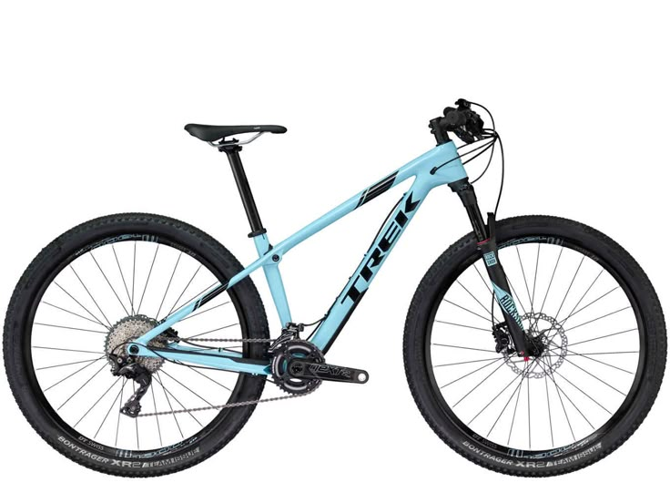
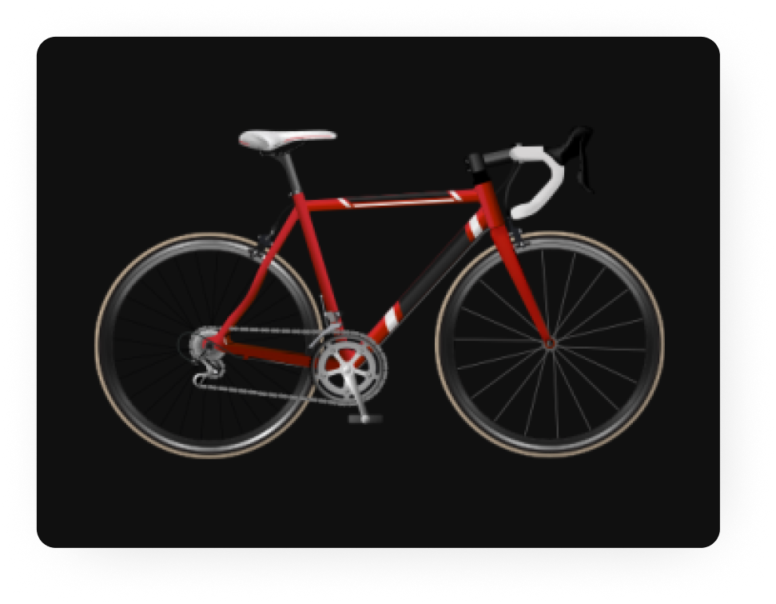
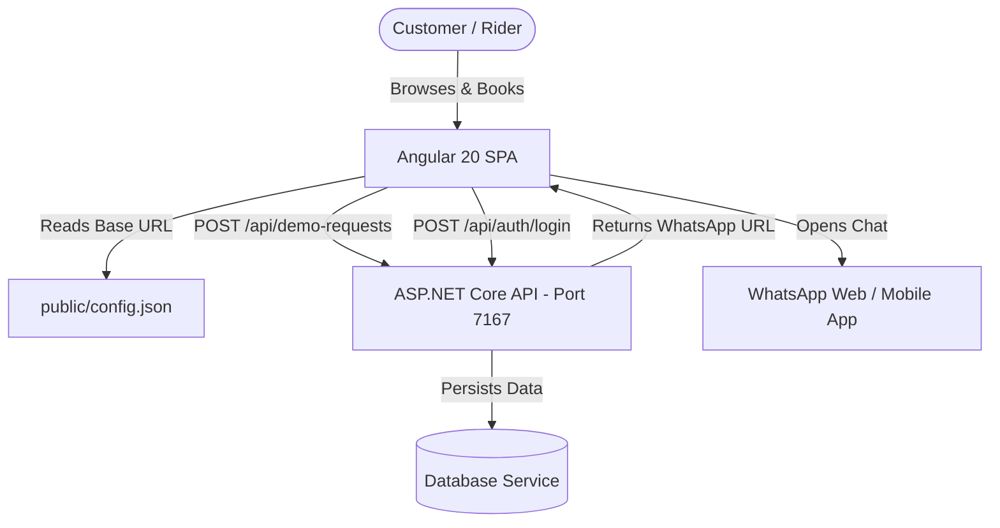

# FreeWheel Bicycle Service Platform 🚲⚡

> **Precision Bicycle Maintenance & Engineering Care.**  
> Built for road racers, downhill competitors, commuters, and bike enthusiasts in Salem, Tamil Nadu, India.

---

## 📌 Project Overview

**FreeWheel** is a high-performance web platform for bicycle servicing and customer intake. Built with **Angular 20**, **PrimeNG 20**, and **TailwindCSS v4**, the application features an automotive-grade **Obsidian Dark** aesthetic.

The platform embodies the competitive downhill racing pedigree of **S. Thilothamma** (National Downhill Mountain Biking Champion and M.E. Manufacturing Engineer) and Master Bicycle Technician **Gokul Krishnan**, delivering zero-tolerance torque accuracy, ultrasonic drivetrain cleans, suspension damper servicing, and digital health diagnostics.

---

## 🚀 Key Features

- **🏆 Brand Story & Founder Pedigree:** Inspiring brand narrative detailing championship racing records, engineering background, and workshop integrity.
- **🛠️ 20+ Service Packages Catalog:** Interactive catalog spanning Maintenance, Performance Tuning, Hydraulic/Wheel Repairs, Pre-Purchase Inspections, and Race Day Prep with real-time category filtering.
- **⚡ Instant Intake Booking:** Fast, responsive customer intake form capturing rider contact details with instant field validation and real-time summary card preview.
- **📲 Direct WhatsApp Dispatch:** On booking submission, the system dispatches details to the backend API and immediately connects the rider to workshop coordinators via WhatsApp Web/Mobile.
- **🔮 Comprehensive Intake Data Specification:** Complete 19-field bicycle intake data model (`service-center-data.ts`) detailing bicycle brands, types, drivetrains, brake mechanisms, wheel diameters, and budget caps.
- **🎨 Obsidian Dark UI Design System:** Deep obsidian black canvas (`#060709`), electric orange brand accents (`#ff5a00`), frosted blueprint glass cards, and staggered scroll reveal animations.
- **⚙️ Dynamic Runtime Configuration:** Decoupled backend URL management via `public/config.json` without requiring rebuilds across deployment stages.

---

## 🛠️ Technology Stack

| Layer | Technology | Version | Description |
| :--- | :--- | :--- | :--- |
| **Framework** | Angular | `^20.3.27` | Standalone Component Architecture, Signals, Vite/esbuild |
| **UI Suite** | PrimeNG | `^20.4.0` | PrimeNG Enterprise UI with Aura theme preset |
| **Theme Engine** | `@primeuix/themes` | `^3.0.0` | Design token abstraction layer |
| **Styling** | TailwindCSS | `^4.3.3` | Modern utility-first CSS engine with `@tailwindcss/postcss` |
| **Iconography** | PrimeIcons | `^8.0.0` | Vector icon library |
| **Reactivity** | RxJS | `~7.8.0` | Reactive HTTP observables and event streams |
| **Language** | TypeScript | `~5.9.2` | Strongly typed JavaScript |
| **Runtime** | Modern Browsers | ES2022+ | Chrome, Firefox, Safari, Edge |

---

## 🖼️ Application Preview

*(Screenshots will be captured and placed in `public/assets/images/`)*

| Landing Page & Parallax Hero | 20+ Service Menu & Filtering |
| :---: | :---: |
|  |  |
| *Hero section with racing pedigree & quick CTA* | *Dynamic category filter with featured badges* |

| Customer Intake Form | Real-Time Live Summary |
| :---: | :---: |
|  |  |
| *10-digit phone and email validation* | *Live preview of customer contact info* |

---

## 🏛️ Architecture Overview



For complete technical and architectural details, refer to:
- 📖 [Product Requirements Document (`prd.md`)](file:///c:/Users/gowth/Desktop/bicycle-service/prd.md)
- 🏗️ [System Architecture (`architecture.md`)](file:///c:/Users/gowth/Desktop/bicycle-service/architecture.md)
- 📏 [Development Rules (`rules.md`)](file:///c:/Users/gowth/Desktop/bicycle-service/rules.md)
- 🎨 [UI/UX Design System (`design.md`)](file:///c:/Users/gowth/Desktop/bicycle-service/design.md)
- 📋 [Task Backlog (`task.md`)](file:///c:/Users/gowth/Desktop/bicycle-service/task.md)
- 🧠 [Agent Memory (`memory.md`)](file:///c:/Users/gowth/Desktop/bicycle-service/memory.md)

---

## 📋 Prerequisites

Ensure the following tools are installed on your machine:
- **Node.js:** `v20.x` or `v22.x` (LTS recommended)
- **npm:** `v10.x` or higher
- **Angular CLI (Optional, globally installed):** `npm install -g @angular/cli@20`

---

## 💻 Installation & Setup

1. **Clone the repository:**
   ```bash
   git clone https://github.com/Gowthaman-03/bicycle-service.git
   cd bicycle-service
   ```

2. **Install dependencies:**
   ```bash
   npm install
   ```

3. **Configure the backend API URL:**
   Open `public/config.json` and configure the URL of your backend API:
   ```json
   {
     "AuthUrl": "https://localhost:7167/"
   }
   ```

4. **Start the local development server:**
   ```bash
   npm start
   ```
   Or using Angular CLI directly:
   ```bash
   ng serve
   ```

5. **Open the application:**
   Navigate to `http://localhost:4200/` in your browser. The app will automatically reload when source files are modified.

---

## 🔌 Backend API Integration

The frontend connects to an external REST API (typically an ASP.NET Core service running locally on HTTPS port `7167`).

### Consumed Endpoints

#### 1. Quick Booking / Demo Request
- **Endpoint:** `POST /api/demo-requests`
- **Payload:**
  ```json
  {
    "name": "Arun Kumar",
    "phoneNumber": "9876543210",
    "email": "arun@example.com",
    "address": "Fairlands, Salem"
  }
  ```
- **Response:**
  ```json
  {
    "whatsAppUrl": "https://api.whatsapp.com/send?phone=919999999999&text=..."
  }
  ```

#### 2. Authentication Login
- **Endpoint:** `POST /api/auth/login`
- **Payload:**
  ```json
  {
    "login": "admin@freewheel.in",
    "Password": "SecretPassword123"
  }
  ```
- **Response:**
  ```json
  {
    "token": "JWT_TOKEN_STRING"
  }
  ```

---

## 🧪 Verified Commands

| Action | Command | Purpose |
| :--- | :--- | :--- |
| **Run Dev Server** | `npm start` | Launches Vite dev server at `http://localhost:4200/` |
| **Production Build** | `npm run build` | Compiles project to `dist/bicycle-service/browser/` |
| **Watch Build** | `npm run watch` | Builds in development watch mode |
| **Run Unit Tests** | `npm test` | Executes unit tests via Karma test runner |

---

## 📂 Project Directory Structure

```
bicycle-service/
├── public/                    # Static runtime assets
│   ├── assets/images/         # Photography, logos, and illustrations
│   ├── config.json            # Runtime environment configuration
│   └── favicon.ico            # Favicon
├── src/
│   ├── app/
│   │   ├── common/            # Shared primitives, directives, and validators
│   │   │   ├── directives/    # ScrollRevealDirective, NoopValueAccessorDirective
│   │   │   ├── function/      # injectNgControl, validation helpers
│   │   │   ├── input-text/    # Reusable form field wrapper with PrimeNG KeyFilter
│   │   │   ├── service/       # authGuard
│   │   │   └── column.ts      # Dynamic form & table column metadata definitions
│   │   ├── features/          # Domain verticals
│   │   │   ├── appointment/   # Quick booking form & WhatsApp integration
│   │   │   ├── auth/          # Login, Register, AuthService
│   │   │   ├── dashboard/     # Management dashboard (stub)
│   │   │   ├── landing/       # Marketing landing page & sections
│   │   │   └── service/       # 20-package service catalog & filters
│   │   ├── shared/            # Common layout components
│   │   │   ├── footer/        # Workshop contact info, hours, social links
│   │   │   └── navbar/        # Glassmorphic header & mobile slide-out drawer
│   │   ├── app.config.service.ts # Runtime config loader
│   │   ├── app.config.ts      # Angular application config & providers
│   │   ├── app.routes.ts      # Route configurations
│   │   └── app.ts             # Root shell component
│   ├── service-center-data.ts # Master service catalog & 19-field intake schema
│   ├── styles.scss            # Obsidian Dark design system tokens & animations
│   ├── main.ts                # App bootstrap entry point
│   └── index.html             # HTML entry with font preconnections
├── angular.json               # Angular workspace configuration
├── package.json               # Dependencies and scripts
└── tsconfig.json              # TypeScript compilation rules
```

---

## 👥 User Roles & Access

- **Public Rider:** Unrestricted access to Landing, Services catalog, and Appointment intake booking.
- **Registered User / Customer:** *(Planned)* View historical service records, bike health cards, and active job-card statuses.
- **Mechanic / Service Technician:** *(Planned)* Inspect active tickets, log inspection checkpoints, update service status.
- **Workshop Admin:** *(Planned)* Manage ticket queues, customer records, pricing catalogs, and workshop analytics.

---

## ⚠️ Current Known Limitations

1. **Backend Service Requirement:** The booking form and login service expect an active backend server at `https://localhost:7167/`.
2. **Deactivated Protected Routes:** The `/login` route, `Dashboard`, and `RegisterComponent` are currently inactive in `app.routes.ts`.
3. **URL Trailing Slash:** `Appointmentservice` appends `/api/demo-requests` to `AuthUrl`, which currently produces a double slash when `AuthUrl` includes a trailing slash.

---

## 🤝 Contribution Guidelines

1. **Follow Standalone Patterns:** All new components must be standalone (`standalone: true`). Do not add `NgModule` files.
2. **Signals First:** Prefer Angular Signals (`signal`, `computed`, `input`) for component state management.
3. **Preserve Design Tokens:** Use `--primary` (`#ff5a00`) and Obsidian backgrounds defined in `styles.scss`.
4. **Test Before Committing:** Always execute `npm run build` and ensure zero TypeScript or build errors before pushing.

---

## 📄 License

This project is proprietary property of **FreeWheel Bicycle Service Center**, Salem, Tamil Nadu, India. All rights reserved.
