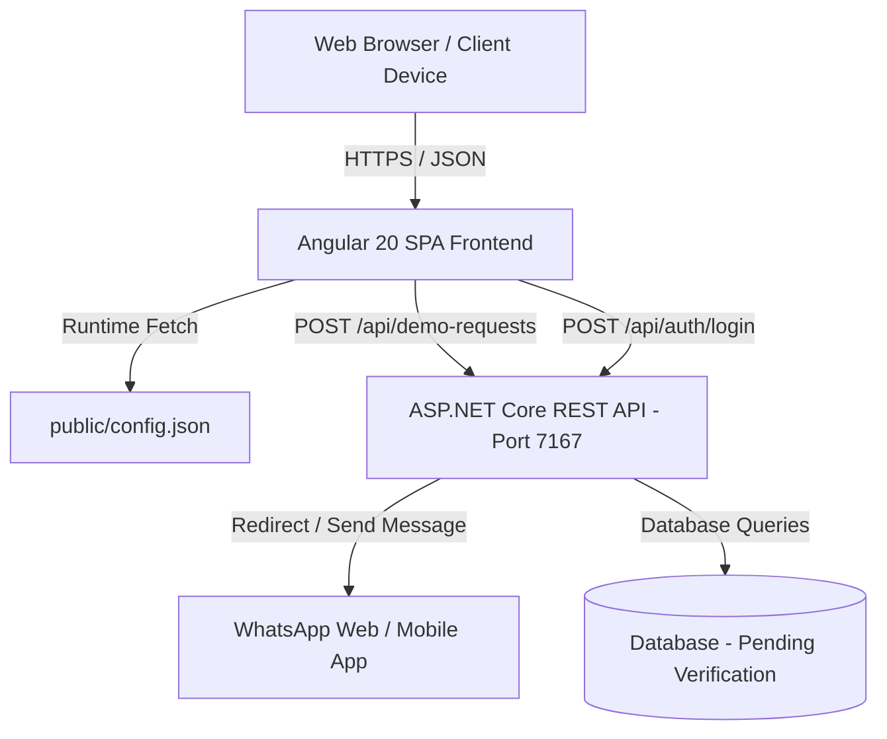
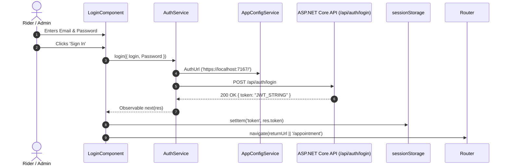
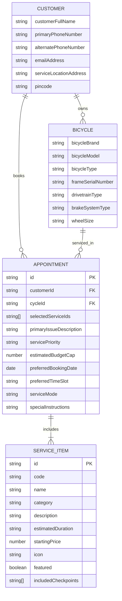
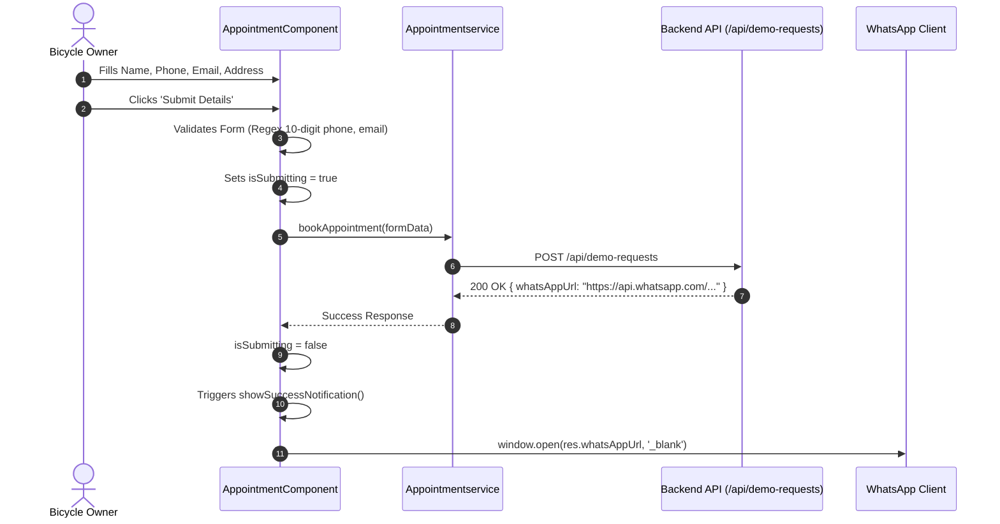

# System Architecture Document
## FreeWheel Bicycle Service Platform

---

## 1. System Overview

The **FreeWheel Bicycle Service Platform** is an enterprise-grade web application tailored for high-end multi-brand bicycle maintenance, precision repairs, and customer intake. The current repository contains the **Angular Single-Page Application (SPA)** client, engineered with Angular 20, PrimeNG 20, TailwindCSS v4, and an Obsidian Dark design system.

The application communicates with an external REST API backend configured dynamically at runtime via `public/config.json`.



---

## 2. Technology Stack & Verified Versions

The versions below are extracted and verified directly from [package.json](file:///c:/Users/gowth/Desktop/bicycle-service/package.json) and [angular.json](file:///c:/Users/gowth/Desktop/bicycle-service/angular.json):

| Layer / Library | Package Name | Verified Version | Purpose |
| :--- | :--- | :--- | :--- |
| **Framework Core** | `@angular/core`, `@angular/common` | `^20.3.27` | Core framework, dependency injection, and change detection |
| **Routing** | `@angular/router` | `^20.3.27` | Client-side routing, route guards, in-memory scroll restoration |
| **Forms** | `@angular/forms` | `^20.2.0` | Reactive forms, custom control accessors, validation |
| **UI Components** | `primeng` | `^20.4.0` | Enterprise UI suite (Drawer, Button, InputText, Password, Checkbox, KeyFilter) |
| **Design Tokens / Theme** | `@primeuix/themes` | `^3.0.0` | Theme engine using Aura preset with custom CSS variables |
| **Iconography** | `primeicons` | `^8.0.0` | High-fidelity vector iconography |
| **CSS Utility Engine** | `tailwindcss`, `@tailwindcss/postcss` | `^4.3.3` | Tailwind v4 modern CSS build pipeline |
| **Reactivity** | `rxjs` | `~7.8.0` | Reactive streams, HTTP observables |
| **Async & Polyfills** | `zone.js`, `tslib` | `^0.15.1`, `^2.3.0` | Zone execution context and TypeScript helpers |
| **Build Engine** | `@angular/build` | `^20.2.0` | Angular Application builder with Vite/esbuild |
| **Language** | `typescript` | `~5.9.2` | Strongly typed JavaScript |
| **Target Runtime** | Evergreen Browsers | ES2022+ | Modern Desktop and Mobile Browsers |

---

## 3. Project Directory Structure & Responsibilities

```
c:\Users\gowth\Desktop\bicycle-service\
├── .angular/                  # Angular CLI build cache
├── .vscode/                   # VS Code editor configuration
├── dist/                      # Production build output
├── public/                    # Static runtime assets
│   ├── assets/images/         # Brand logos, cyclist hero images, workshop photography
│   ├── config.json            # Runtime environment configuration (AuthUrl)
│   └── favicon.ico            # Application favicon
├── src/
│   ├── app/
│   │   ├── common/            # Reusable core directives, controls, models, guards
│   │   │   ├── directives/    # ScrollRevealDirective, NoopValueAccessorDirective
│   │   │   ├── function/      # injectNgControl, validation utilities (getErrorMessages, markAllDirty)
│   │   │   ├── input-text/    # Generic input wrapper with PrimeNG KeyFilter and error bindings
│   │   │   ├── service/       # authGuard (Functional CanActivateFn)
│   │   │   └── column.ts      # Metadata column interface for declarative form/table generation
│   │   ├── features/          # Domain feature modules
│   │   │   ├── appointment/   # Service intake form, booking service, live summary card
│   │   │   ├── auth/          # Login component, register placeholder, auth service
│   │   │   ├── dashboard/     # Management dashboard component (stub)
│   │   │   ├── landing/       # Customer-facing marketing showcase (Hero, About, WhyUs, HowItWorks)
│   │   │   └── service/       # 20+ Bicycle service packages catalog with category filters
│   │   ├── shared/            # Common layout components
│   │   │   ├── footer/        # Workshop bio, contact info, business hours, social links
│   │   │   └── navbar/        # Glassmorphic header, desktop links, PrimeNG mobile drawer
│   │   ├── app.config.service.ts # Runtime HTTP configuration loader
│   │   ├── app.config.ts      # Application providers (routes, PrimeNG Aura, HttpClient)
│   │   ├── app.routes.ts      # Route declarations
│   │   └── app.ts / app.html  # Root component shell
│   ├── service-center-data.ts # Master catalog data model and 19-field customer intake specification
│   ├── styles.scss            # Global Obsidian Dark design tokens, animations, scrollbars
│   ├── main.ts                # Application bootstrap entry point
│   └── index.html             # HTML root document with Google Fonts preconnections
├── angular.json               # Angular workspace build & test configurations
├── package.json               # Dependencies and build scripts
└── tsconfig.json              # TypeScript compiler configuration
```

---

## 4. Angular Component & State Architecture

### 4.1 Standalone Components & Signal Usage
The project strictly adopts modern **Angular Standalone Component architecture** (no `NgModule` declarations):
- **Signals for State:**
  - `title = signal('bicycle-service')` in [app.ts](file:///c:/Users/gowth/Desktop/bicycle-service/src/app/app.ts).
  - `appConfig = signal<config | undefined>(undefined)` in [app.config.service.ts](file:///c:/Users/gowth/Desktop/bicycle-service/src/app/app.config.service.ts).
  - `formControlArray = signal(...)` and `formControls = computed(...)` in [login.ts](file:///c:/Users/gowth/Desktop/bicycle-service/src/app/features/auth/login/login.ts) for declarative form generation from metadata.
- **Component Inputs via Signal Inputs:**
  - `label = input.required<string>()` in [input-text.ts](file:///c:/Users/gowth/Desktop/bicycle-service/src/app/common/input-text/input-text.ts).
  - `type = input<'text' | 'int' | 'number' | 'money' | 'alpha' | 'alphanum'>('text')`.
- **Form Control Value Accessor Injection:**
  - `injectNgControl()` utilizes `{ self: true, optional: true }` dependency injection to bind PrimeNG input components directly to reactive form controls without boilerplate value accessors.

---

## 5. Routing & Navigation Structure

Routes are defined in [app.routes.ts](file:///c:/Users/gowth/Desktop/bicycle-service/src/app/app.routes.ts):

| Path | Component | Guard Status | Purpose |
| :--- | :--- | :--- | :--- |
| `''` | `Landing` | None (`authGuard` commented out) | Brand story, pedigree, workflow, quick CTA |
| `'service'` | `ServicesComponent` | None (`authGuard` commented out) | 20+ Service catalog with category filtering |
| `'appointment'` | `AppointmentComponent` | None (`authGuard` commented out) | Quick service booking and customer intake |
| `'login'` | `LoginComponent` | Deactivated (commented out) | Authentication entry point |
| `'**'` | Wildcard | Redirect to `''` | Fallback catch-all redirection |

### Scroll Behavior
Configured in [app.config.ts](file:///c:/Users/gowth/Desktop/bicycle-service/src/app/app.config.ts):
```typescript
withInMemoryScrolling({
  scrollPositionRestoration: 'top',
  anchorScrolling: 'enabled',
})
```
This enables anchor jumps (`#about`, `#services`, `#how-it-works`, `#contact`) while ensuring top-of-page restoration on route transitions.

---

## 6. Authentication, Authorization & Security Flow

### 6.1 Authentication Workflow



### 6.2 Token Management & Authorization Headers
- **Token Storage:** Stored in `sessionStorage` under key `'token'`.
- **Header Generation:** [auth.service.ts](file:///c:/Users/gowth/Desktop/bicycle-service/src/app/features/auth/auth.service.ts) exposes:
  ```typescript
  getAuthHeader() {
    const token = sessionStorage.getItem('token');
    return new HttpHeaders().set('Authorization', `Bearer ${token}`);
  }
  ```
- **Guard Logic:** [auth.guard.ts](file:///c:/Users/gowth/Desktop/bicycle-service/src/app/common/service/auth.guard.ts) inspects `authService.isAuthenticated()` (`!!sessionStorage.getItem('token')`). If false, it redirects to `/login` with `queryParams: { returnUrl: state.url }`.

---

## 7. API Communication & Service Layer

### 7.1 Runtime Environment Loading (`AppConfigService`)
Unlike build-time environment files, the application uses **runtime configuration loading**:
- On application bootstrap, `AppConfigService` fetches `/config.json` via HTTP.
- Sets `appConfig` signal containing `AuthUrl: "https://localhost:7167/"`.
- Exposes getter `get AuthUrl()` for feature services.

### 7.2 Verified API Endpoints

#### Endpoint 1: User Login
- **URL:** `${AuthUrl}api/auth/login`
- **Method:** `POST`
- **Caller:** `AuthService.login(data)` in [auth.service.ts](file:///c:/Users/gowth/Desktop/bicycle-service/src/app/features/auth/auth.service.ts#L23-L25)
- **Request Payload:**
  ```json
  {
    "login": "user@example.com",
    "Password": "password123"
  }
  ```
- **Expected Response:**
  ```json
  {
    "token": "eyJhbGciOiJIUzI1NiIsInR5..."
  }
  ```

#### Endpoint 2: Appointment / Demo Request Booking
- **URL:** `${AuthUrl}/api/demo-requests`
- **Method:** `POST`
- **Caller:** `Appointmentservice.bookAppointment(data)` in [appointmentservice.ts](file:///c:/Users/gowth/Desktop/bicycle-service/src/app/features/appointment/appointmentservice.ts#L12-L14)
- **Request Payload:**
  ```json
  {
    "name": "Rider Name",
    "phoneNumber": "9876543210",
    "email": "rider@example.com",
    "address": "Salem, Tamil Nadu"
  }
  ```
- **Expected Response:**
  ```json
  {
    "whatsAppUrl": "https://api.whatsapp.com/send?phone=...&text=..."
  }
  ```
- **Client Side Behavior:** On successful response, the client displays a 6-second success toast notification and executes `window.open(res.whatsAppUrl, '_blank')`.

---

## 8. Data Models & Entity Relationships

The core data schemas are defined in [service-center-data.ts](file:///c:/Users/gowth/Desktop/bicycle-service/src/service-center-data.ts) and [column.ts](file:///c:/Users/gowth/Desktop/bicycle-service/src/app/common/column.ts).



---

## 9. Booking & Dispatch Workflow



---

## 10. Deployment Architecture

### 10.1 Frontend Compilation
- **Builder:** `@angular/build:application` using esbuild and Vite development server.
- **Output Directory:** `dist/bicycle-service/browser/`.
- **Static Hosting Targets:** Compatible with any standard static web host or reverse proxy:
  - Nginx / Apache
  - Azure Static Web Apps / AWS S3 + CloudFront
  - Cloudflare Pages / Vercel / Netlify
- **SPA Routing Requirement:** All server routes must rewrite to `/index.html`.

### 10.2 Backend Integration Assumption
- The backend runs on an ASP.NET Core HTTPS port (`7167`).
- **CORS Configuration Required:** The backend API must permit CORS origins:
  - `http://localhost:4200` (Local development)
  - `https://<production-frontend-domain>`
- Standard headers to allow: `Content-Type`, `Authorization`.
